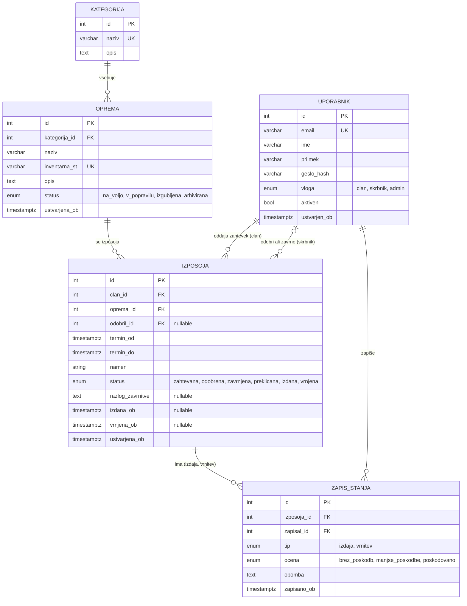
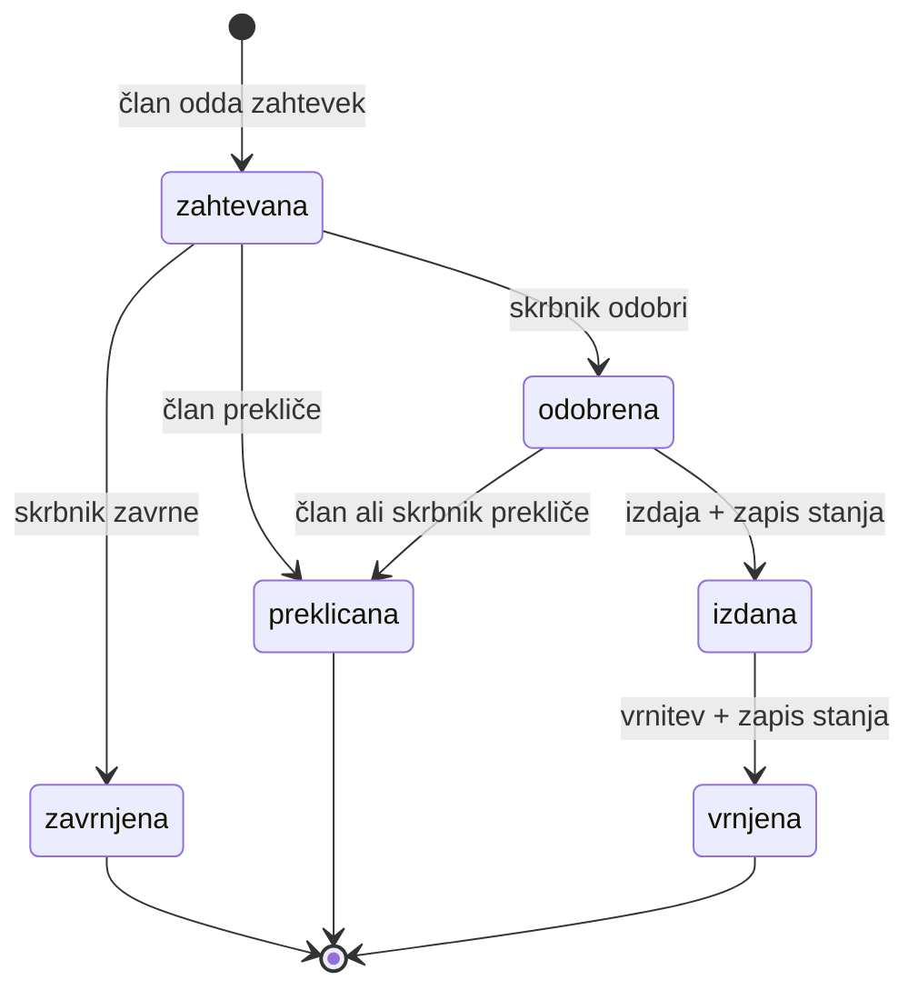

Za podatkovno bazo bomo uporabili PostgreSQL. Model vsebuje pet povezanih entitet: `uporabnik`, `kategorija`, `oprema`, `izposoja` in `zapis_stanja`.

### Diagram (ER)

### Opis entitet

#### Uporabnik

Vsi uporabniki sistema. Vloga določa pravice [[02-funkcionalnosti-in-obseg]].
Link do razlage: [PostgreSQL Primary Key](https://www.pgtutorial.com/postgresql-tutorial/postgresql-primary-key/)

| Polje        | Tip             | Opis                                      |
| ------------ | --------------- | ----------------------------------------- |
| id           | int, PK         | GENERATED ALWAYS AS IDENTITY PRIMARY KEY  |
| email        | varchar, unique | prijavno ime                              |
| ime          | varchar         |                                           |
| priimek      | varchar         |                                           |
| geslo_hash   | varchar         | zgoščeno geslo (nikoli v jasnem besedilu) |
| vloga        | enum            | `clan`, `skrbnik`, `admin`                |
| aktiven      | boolean         | blokiran uporabnik se ne more prijaviti   |
| ustvarjen_ob | timestamptz     |                                           |

### `kategorija`

Razvrstitev opreme (kamere, mikrokontrolerji, merilniki …).

| Polje | Tip             | Opis                                     |
| ----- | --------------- | ---------------------------------------- |
| id    | int, PK         | GENERATED ALWAYS AS IDENTITY PRIMARY KEY |
| naziv | varchar, unique |                                          |
| opis  | text            |                                          |

### `oprema`

Posamezen fizični kos opreme.

| Polje         | Tip              | Opis                                                                                      |
| ------------- | ---------------- | ----------------------------------------------------------------------------------------- |
| id            | int, PK          | GENERATED ALWAYS AS IDENTITY PRIMARY KEY                                                  |
| kategorija_id | FK -> kategorija |                                                                                           |
| naziv         | varchar          |                                                                                           |
| inventarna_st | varchar, unique  | oznaka na napravi                                                                         |
| opis          | text, nullable   |                                                                                           |
| status        | enum             | `na_voljo`, `v_popravilu`, `izgubljena`, `arhivirana`, samo `na_voljo` se lahko rezervira |
| ustvarjena_ob | timestamptz      |                                                                                           |

### `izposoja`

Osrednja entiteta: en zahtevek in njegov življenjski krog.

| Polje                 | Tip                       | Opis                                                                    |
| --------------------- | ------------------------- | ----------------------------------------------------------------------- |
| id                    | int, PK                   | GENERATED ALWAYS AS IDENTITY PRIMARY KEY                                |
| clan_id               | FK -> uporabnik           | kdo si izposoja                                                         |
| oprema_id             | FK -> oprema              |                                                                         |
| odobril_id            | FK -> uporabnik, nullable | skrbnik, ki je odločil o zahtevku                                       |
| termin_od, termin_do  | timestamptz               | zahtevani termin                                                        |
| namen                 | text                      |                                                                         |
| status                | enum                      | `zahtevana`, `odobrena`, `zavrnjena`, `preklicana`, `izdana`, `vrnjena` |
| razlog_zavrnitve      | text, nullable            | obvezen ob zavrnitvi                                                    |
| izdana_ob, vrnjena_ob | timestamptz, nullable     | dejanski čas izdaje in vrnitve                                          |
| ustvarjena_ob         | timestamptz               |                                                                         |

**Zamuda** ni shranjeno stanje, ampak izpeljana vrednost: izposoja je zamujena, če je `status = 'izdana'` in `termin_do < now()`. Takrat ni potrebe po občasnem opravilu, ki bi posodabljalo stanja, seznam zamud pa je običajna poizvedba.

### `zapis_stanja`

Zapis o stanju opreme ob izdaji in ob vrnitvi. Primerjava obeh zapisov pokaže, ali je prišlo do poškodbe.

| Polje       | Tip             | Opis                                             |
| ----------- | --------------- | ------------------------------------------------ |
| id          | int, PK         | GENERATED ALWAYS AS IDENTITY PRIMARY KEY         |
| izposoja_id | FK -> izposoja  |                                                  |
| zapisal_id  | FK -> uporabnik | skrbnik, ki je zapis vnesel                      |
| tip         | enum            | `izdaja`, `vrnitev`                              |
| ocena       | enum            | `brez_poskodb`, `manjse_poskodbe`, `poskodovano` |
| opomba      | text, nullable  |                                                  |
| zapisano_ob | timestamptz     |                                                  |

Omejitev: `UNIQUE (izposoja_id, tip)`, torej največ en zapis ob izdaji in en ob vrnitvi. Zapisi se po vnosu ne spreminjajo in ne brišejo (aplikacija ne ponuja urejanja, bazi pa se odvzame pravica `UPDATE`/`DELETE` na tej tabeli).

### Povezave

| Povezava                             | Kardinalnost | Pomen                                      |
| ------------------------------------ | ------------ | ------------------------------------------ |
| kategorija -> oprema                 | 1 : N        | kategorija vsebuje več kosov opreme        |
| uporabnik -> izposoja (`clan_id`)    | 1 : N        | član ima več izposoj                       |
| uporabnik -> izposoja (`odobril_id`) | 0..1 : N     | skrbnik odloči o več zahtevkih             |
| oprema -> izposoja                   | 1 : N        | isti kos opreme se izposoja večkrat        |
| izposoja -> zapis_stanja             | 1 : 0..2     | največ zapis ob izdaji in zapis ob vrnitvi |
| uporabnik -> zapis_stanja            | 1 : N        | skrbnik zapiše več stanj                   |

### Prehodi stanj izposoje

