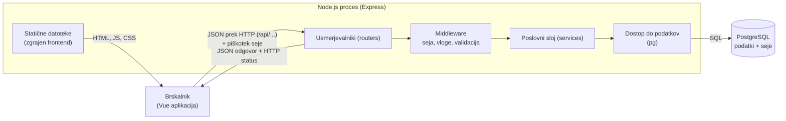

### Arhitektura

#### Glavni deli sistema

SposodimSI je spletna aplikacija z ločenim **frontendom** (Vue 3, enostranska aplikacija) in **REST API-jem** (Node.js z Expressom, JSON). Backend izvaja poslovna pravila in komunicira s PostgreSQL. Frontend ne dostopa do baze neposredno, vse gre prek API-ja. Pri razvoju frontend streže Vite, v produkciji pa zgrajeno aplikacijo postreže Express, zato je naslov en sam.

|Del|Odgovornost|
|---|---|
|**Frontend (Vue 3)**|Prikaz strani, obrazci, usmerjanje (Vue Router), klici API-ja (`fetch`), skeniranje QR kod|
|**Express API**|Usmerjanje, avtentikacija in vloge, validacija, JSON odgovori, postrežba zgrajenega frontenda|
|**Poslovni sloj (services)**|Pravila izposoje: konflikti terminov, prehodi stanj, zapisi stanja, zamude|
|**Dostop do podatkov**|Parametrizirane SQL poizvedbe prek knjižnice pg|
|**PostgreSQL**|Trajno shranjevanje podatkov in sej|

#### Diagram

#### Komunikacija med deli

1. Brskalnik naloži Vue aplikacijo (statične datoteke), ta pa nato kliče API z `fetch('/api/...')` in JSON podatki.
2. Middleware prebere sejo iz piškotka, preveri vlogo in validira vnos. Usmerjevalnik pokliče poslovni sloj, ki izvede pravila v transakciji.
3. API vrne JSON in HTTP status, Vue pa osveži prikaz.

#### Podatkovna baza

PostgreSQL, ena baza za podatke in seje. Shema je opisana v [[03-podatkovni-model]]. Dostop poteka z golim SQL-om prek knjižnice pg, z uporabo povezovalnega bazena (`pg.Pool`).

#### Avtentikacija in upravljanje uporabnikov

- **Seje na strežniku** (express-session), shranjene v PostgreSQL (connect-pg-simple). Brskalnik hrani le piškotek z identifikatorjem seje (httpOnly, sameSite=lax); frontend ne shranjuje nobenega žetona.
- **Gesla** so zgoščena z `bcrypt`; v bazi je samo _geslo_hash_.
- **Registracija** ustvari račun z vlogo `clan`. Vloge `skrbnik` in `admin` dodeljuje administrator.
- **Avtorizacija:** middleware `requireRole(skrbnik)` varuje poti glede na vlogo, blokirani uporabniki (`aktiven = false`) se ne morejo prijaviti. Vue Router skrije strani in gumbe glede na vlogo iz `GET /api/auth/me`, a pravila vedno preverja API.
- **CORS ni potreben**, ker brskalnik vidi en izvor (pri razvoju Vite preusmerja `/api` na backend).
- **CSRF zaščita:** piškotek `sameSite=lax`, API sprejema samo `Content-Type: application/json`, zahteve `GET` ne spreminjajo stanja.

#### Način lokalnega zagona

PostgreSQL teče v Dockerju (Docker Compose), backend in frontend (Vite) pa neposredno z Node.js v dveh terminalih. Vite preusmerja zahteve `/api` na backend. Dovolj za lokalen razvoj.

### Tehnološki sklad

|Področje|Tehnologija|Opomba|
|---|---|---|
|**Frontend**|Vue 3, Vue Router, Vite, Bootstrap 6 (še v alpha verziji, CSS), `fetch`|enostranska aplikacija, gradnja z Vite|
|**Backend**|Node.js (LTS) + Express|REST API, middleware, poslovna pravila|
|**Podatkovna baza**|PostgreSQL 18|podatki in seje|
|**Dostop do baze**|`pg` (node-postgres)|parametrizirane poizvedbe, transakcije|
|**Avtentikacija**|`express-session`, `connect-pg-simple`, `bcrypt`|seje na strežniku|
|**Zaščita**|`helmet`||
|**Validacija vnosa**|`express-validator`|preverjanje JSON vsebine zahtev|
|**QR kode**|`qrcode` (generiranje), `qr-scanner` (skeniranje v brskalniku, npm paket)|skeniranje potrebuje `localhost` ali HTTPS|
|**Lokalni razvoj**|Docker Compose (baza), Vite dev strežnik s posrednikom, `nodemon`, `dotenv`|osvežitev ob spremembi kode v obeh projektih|
|**Testiranje**|`node:test` (vgrajen)|testi poslovnih pravil (konflikti, prehodi stanj)|

### Arhitekturne odločitve

1. **Ločen frontend in REST API.** Prikaz in logika sta ločena, API je mogoče preizkusiti neodvisno (curl, Postman), isti API pa lahko pozneje uporablja drug odjemalec.
2. **Vue 3 z Vite.** Ogrodje s komponentami (`.vue` datoteke), ki ima preprosto sintakso in uradni usmerjevalnik. Za naše strani (prijava, katalog, obrazci, tabele) zadošča z manj kode kot React. Slabost: dodaten projekt z gradnjo.
3. **Posrednik v razvoju, Express v produkciji.** Vite med razvojem preusmerja `/api` na backend, v produkciji pa Express postreže zgrajeno mapo `dist`. En izvor pomeni, da piškotek seje deluje brez CORS-a.
4. **Express brez dodatnega ogrodja.** Majhno in dobro znano ogrodje. Struktura (routes -> services -> db) ohranja poslovna pravila ločena od usmerjanja in jih naredi preizkušljiva.
5. **SQL (`pg`) namesto ORM.** Podatkovni model je že opisan v SQL-u, poizvedbe (npr. preverjanje prekrivanja terminov, seznam zamud). Prenaša se preko parametrov.
6. **PostgreSQL.** Relacijski model z veliko povezavami, transakcije za prehode stanj in tipi `enum` ter `timestamptz`.
7. **Seje na strežniku (v PostgreSQL) namesto JWT.** Edini odjemalec je brskalnik, zato piškotek `httpOnly` zadošča in žetona ni treba hraniti v JavaScriptu. Seja omogoča takojšen preklic, ne potrebujemo Redisa, seje pa preživijo ponovni zagon.
8. **Poslovna pravila v poslovnem sloju.** Prehodi stanj in preverjanje konfliktov potekajo v transakciji znotraj `services/`, ne glede na to, od kod pride klic.
9. **REST s HTTP statusi in enotnim formatom napak.** Ločene poti za vsak prehod stanja omogočajo preprosto preverjanje vlog.
10. **Docker samo za bazo.** Razvoj ostane hiter, baza pa je pri vseh enaka. Dockerfile za aplikacijo je mogoče dodati pozneje.

### Minimalne zahteve za projekt

|Zahteva|Kako je izpolnjena|
|---|---|
|Spletna rešitev, ne zgolj statične strani|Vue aplikacija in Express API z dinamičnimi podatki in poslovnimi pravili|
|Vsaj tri uporabniške vloge|član, skrbnik opreme, administrator ([[02-funkcionalnosti-in-obseg]])|
|Vsaj tri povezane entitete|pet entitet s tujimi ključi ([[03-podatkovni-model]])|
|Shranjevanje v podatkovno bazo|PostgreSQL|
|Osnovna avtentikacija in upravljanje uporabnikov|prijava, registracija, seje, vloge, blokiranje|
|Vsaj en netrivialen delovni proces|življenjski krog izposoje s preverjanjem konfliktov in zapisi stanja|
|10–15 predvidenih funkcionalnosti|14 funkcionalnosti|
|5–7 funkcionalnosti za MVP|7 funkcionalnosti|
|Vsaj 5 kasnejših nadgradenj|7 nadgradenj|
|Vsaj 3 funkcionalnosti izven obsega|6 točk|
|Možnost nadaljnjega razvoja|ločen REST API in poslovni sloj, drug odjemalec lahko uporabi isti API|