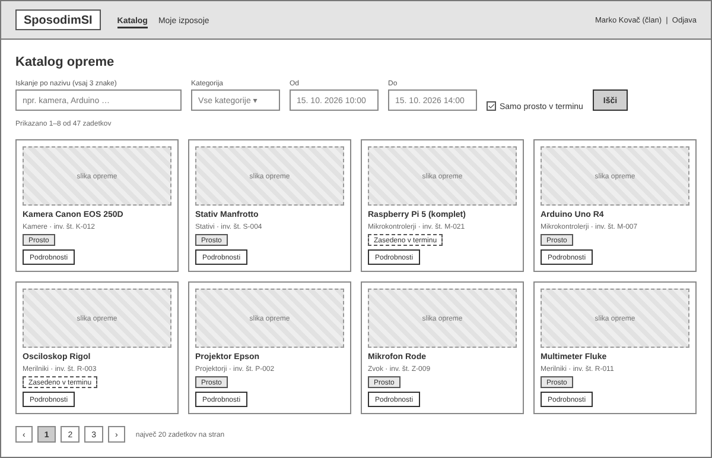
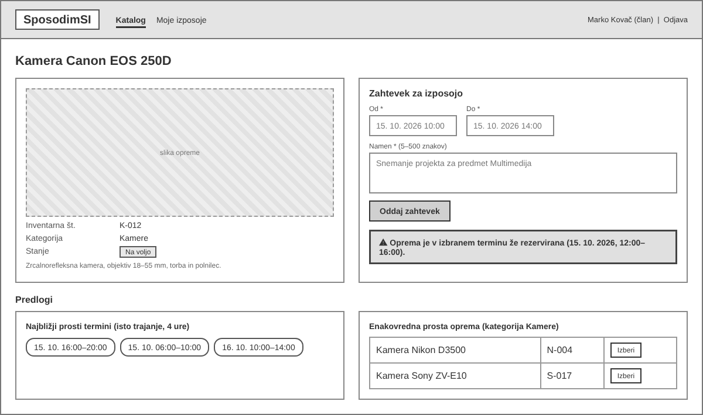
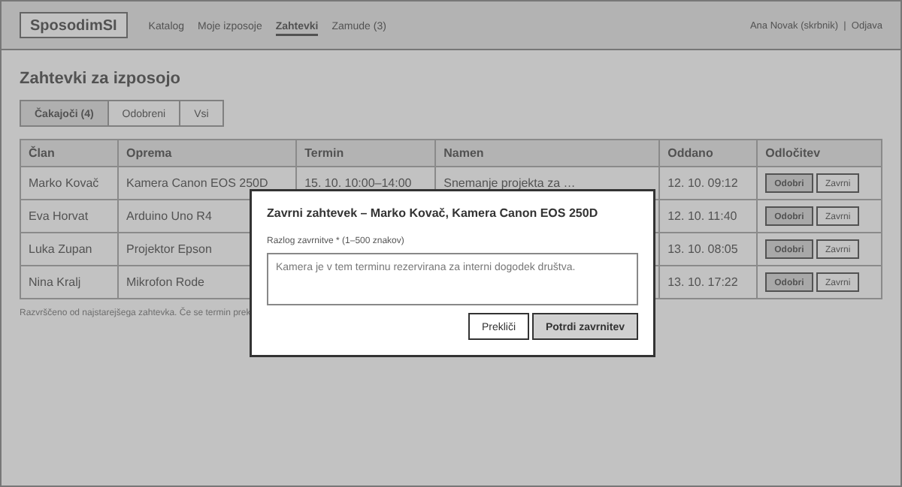
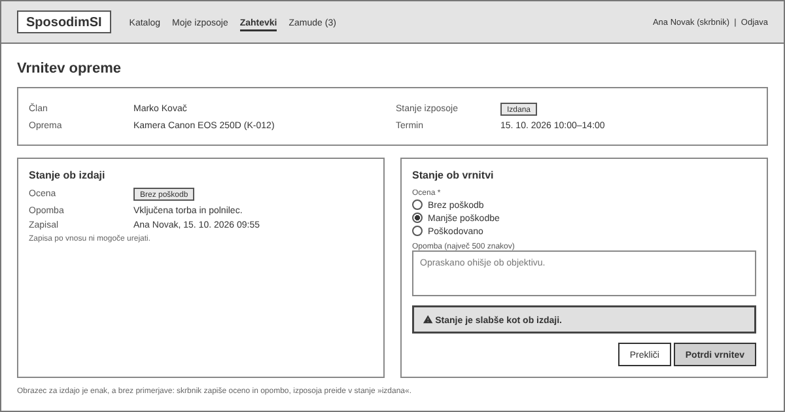
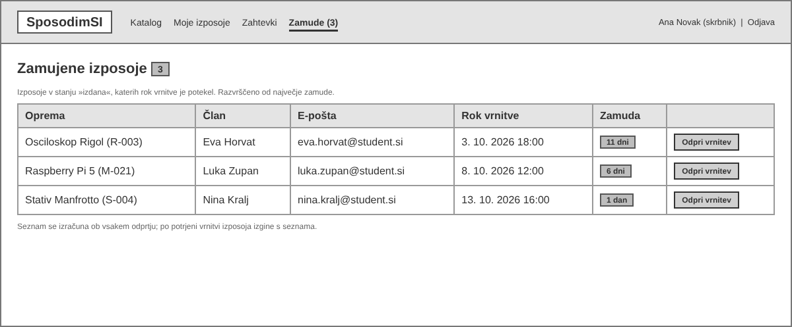

# Katalog

Zaslon ima zgoraj iskalnik z iskanjem po nazivu, filtrom kategorije, poljema Od in Do ter stikalom "Samo prosto v terminu". Pod njimi so kartice opreme z oznako "Prosto" ali "Zasedeno v terminu".

## 2. Podrobnosti opreme, zahtevek in predlogi ob konfliktu

Levo so podatki o opremi, desno obrazec z obveznimi polji Od, Do in Namen. Ob prekrivanju terminov se pod gumbom prikaže opozorilo z zasedenim terminom. Pod obrazcem so predlogi: najbližji prosti termini z enakim trajanjem in enakovredna prosta oprema iz iste kategorije. Klik na predlog izpolni obrazec.

## 3. Zahtevki za izposojo (skrbnik)

Tabela čakajočih zahtevkov (od najstarejšega) z gumboma "Odobri" in "Zavrni" v vsaki vrstici. Ob zavrnitvi se odpre pogovorno okno z obveznim poljem za razlog.

## 4. Vrnitev opreme s primerjavo stanja

Zgoraj so podatki o izposoji. 

Levo je nespremenljiv zapis stanja ob izdaji, desno obrazec za stanje ob vrnitvi (ocena in opomba). Če je ocena slabša kot ob izdaji, se prikaže opozorilo. Obrazec za izdajo je enak, a brez leve strani s primerjavo.

## 5. Zamujene izposoje

Seznam izdanih izposoj, katerih rok vrnitve je potekel, razvrščen od največje zamude. Vsaka vrstica prikaže opremo, člana, e-pošto, rok in število dni zamude. Povezava "Zamude (3)" v meniju prikazuje število zamud, gumb "Odpri vrnitev" pa vodi na [[wf-04-vrnitev-primerjava-stanja.png]].